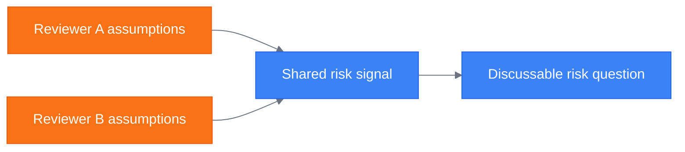

# Reviewers need one shared risk signal

- Same diff, different assumptions
- Late risk discovery

<!--
PRESENTER NOTES:
Opening: "A diff can be technically correct and still produce different merge decisions."
Key points:
- Reviewers need an explicit risk signal.
- Naming the uncertainty makes it discussable.
Transition: "The next slide turns that signal into a repeatable loop."
Timing: 60 seconds
Word count: ~12 words excluding title
-->
