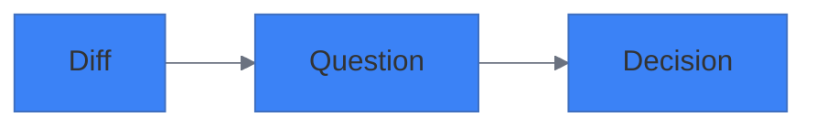

# Three review steps turn ambiguity into a decision

::left::

- Read the diff
- Ask one risk question
- Record the decision

::right::

<!--
PRESENTER NOTES:
Explain the loop from left to right. Keep the question close to the change and record the decision while context is fresh.
Timing: 90 seconds
-->
