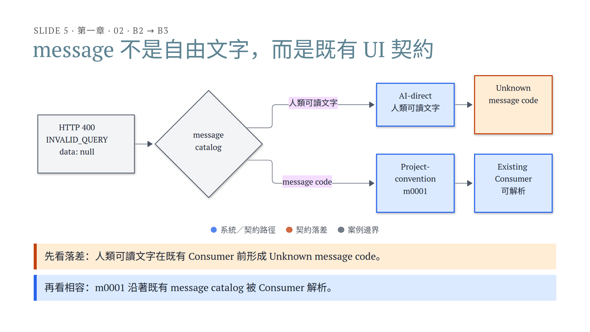
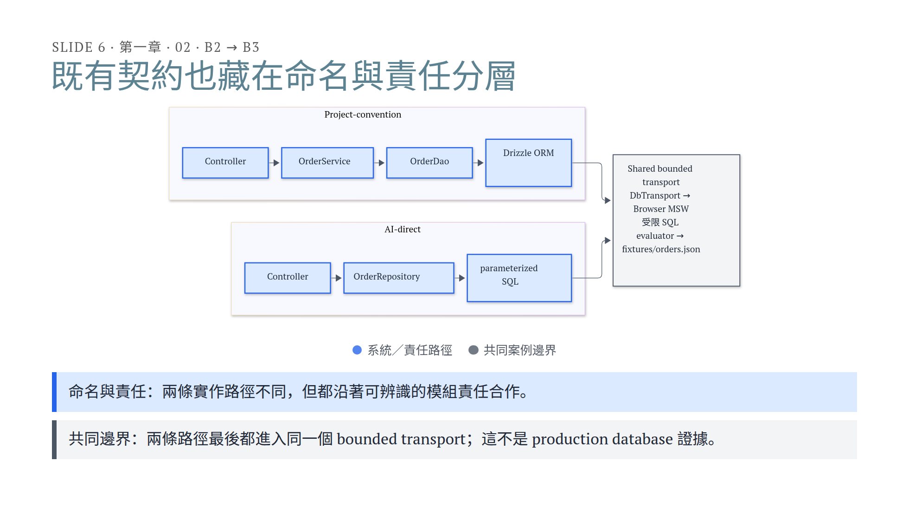
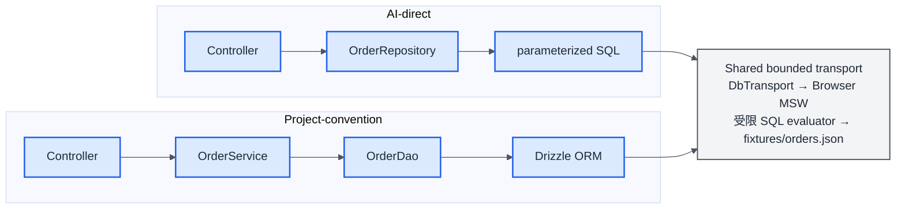
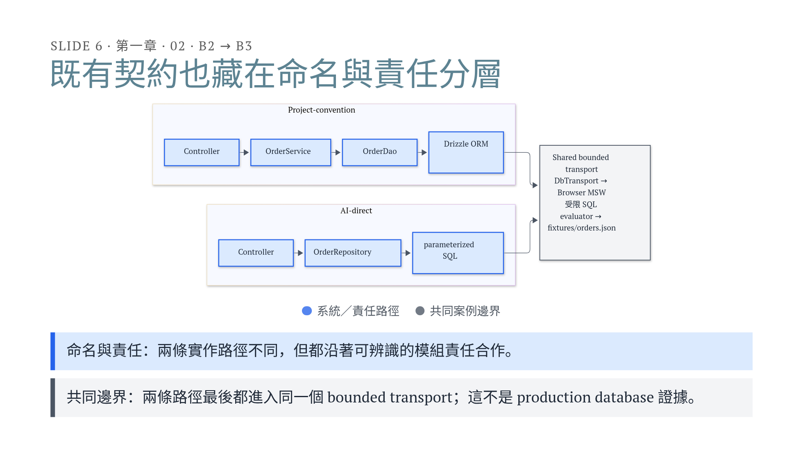
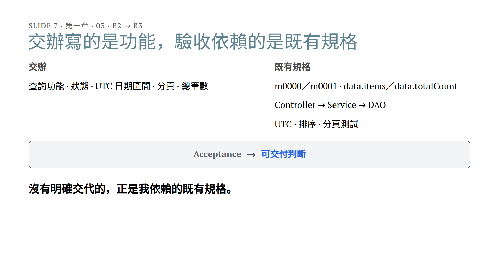
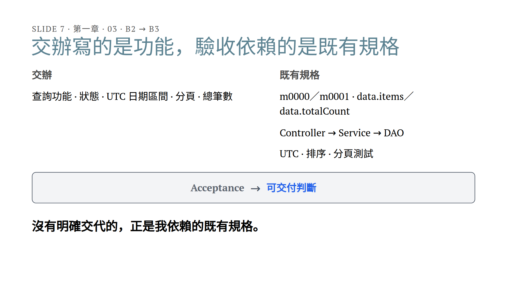
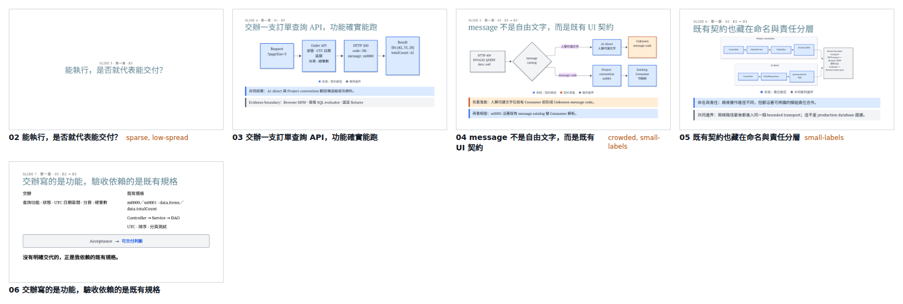

# Balance report

Run: `20261126-114923`

Thresholds: fill 0.35 to 0.75, vertical spread at least 0.55, body text at least 18pt, diagram labels at least 14pt, column ratio at least 0.75.

## Summary

| Status | Slides |
|---|---|
| Balanced | 2 |
| Fixed (auto) | 1 |
| Fixed (approved) | 0 |
| Skipped | 2 |
| Pending image | 0 |
| Handed back | 0 |
| Failing: overflow | 0 |
| Render failed | 0 |
| Hidden (skipped) | 0 |
| Merged into a neighbor | 0 |
| Flagged, unresolved | 0 |
| Total | 5 |

## All slides

| Slide | Layout | Fill | Spread | Flags | Status |
|---|---|---|---|---|---|
| 02 | center | 0.06 | 0.55 | sparse, low-spread | balanced (intentional) |
| 03 | default | 0.60 | 0.81 | none | balanced |
| 04 | default | 0.79 | 0.91 | crowded, small-labels | skipped |
| 05 | default | 0.65 | 0.92 | small-labels | skipped |
| 06 | default | 0.38 | 0.83 | none | fixed (auto) |

## Flagged and changed slides

### Slide 02

- Status: **balanced (intentional)**
- Source: `slides/03-execution-vs-delivery.md` lines 1 to 23
- Layout: `center`
- Remaining flags: sparse, low-spread

Before (round 1) and after (round 3):

 

| Round | Fill | Spread | Overflow | Body pt | Label pt | Words | Elements | Columns | Flags |
|---|---|---|---|---|---|---|---|---|---|
| 1 | 0.06 | 0.55 | no | n/a | n/a | 4 | 0 | n/a | sparse, low-spread |
| 3 | 0.06 | 0.55 | no | n/a | n/a | 4 | 0 | n/a | sparse, low-spread |

**Verdict:** sparse, intentional: yes.
Reason: The rendered slide is a centered title-only section opener: a chapter kicker and one large question are intentionally isolated with ample whitespace. The sparse and low-spread flags support the opening pause rather than indicating missing content.

**Decisions:**

- round 1 `verdict-intentional` (auto): skipped at 2026-11-26T03:54:20Z. The centered title-only section opener intentionally uses whitespace as a pause; sparse and low-spread are measuring artifacts for this slide kind.
  - After: 

### Slide 04

- Status: **skipped**
- Source: `slides/05-message-contract.md` lines 1 to 54
- Layout: `default`
- Remaining flags: crowded, small-labels

Before (round 1) and after (round 3):

 

| Round | Fill | Spread | Overflow | Body pt | Label pt | Words | Elements | Columns | Flags |
|---|---|---|---|---|---|---|---|---|---|
| 1 | 0.79 | 0.91 | no | n/a | 13.3 | 22 | 1 | n/a | crowded, small-labels |
| 3 | 0.79 | 0.91 | no | n/a | 13.3 | 22 | 1 | n/a | crowded, small-labels |

**Verdict:** balanced, intentional: no.
Reason: The central branching diagram, legend, and two takeaway bars are distributed across the canvas with clear margins; the crowded flag is mild, but several diagram labels render below the 14pt minimum.

Ranked fixes:

1. `diagram-resize` (approval): Simplify repeated diagram labels so Mermaid can render the key paths at a larger readable size. (projected 1 elements, 18 words)

**Decisions:**

- round 2 `diagram-resize` (approval): skipped at 2026-11-26T05:12:37Z. The diagram-resize candidate was skipped by human approval. Although it improved measured label size and density, it weakened the comparison symmetry between the two implementations and reduced the semantic precision of the message-code contract.
  - After: 

### Slide 05

- Status: **skipped**
- Source: `slides/06-responsibility-layering.md` lines 1 to 56
- Layout: `default`
- Remaining flags: small-labels

Before (round 1) and after (round 3):

 

| Round | Fill | Spread | Overflow | Body pt | Label pt | Words | Elements | Columns | Flags |
|---|---|---|---|---|---|---|---|---|---|
| 1 | 0.62 | 0.90 | no | n/a | 9.5 | 15 | 1 | n/a | small-labels |
| 2 | 0.65 | 0.92 | no | n/a | 9.4 | 15 | 1 | n/a | small-labels |
| 3 | 0.65 | 0.92 | no | n/a | 9.4 | 15 | 1 | n/a | small-labels |

**Verdict:** balanced, intentional: no.
Reason: The diagram and two annotations fill the canvas with strong vertical spread and no clipping, so the overall density is balanced. However, the diagram labels are visibly small, matching the 9.39pt minimum and the small-labels flag.

Ranked fixes:

1. `diagram-resize` (approval): Increase Mermaid diagram label sizing to 19px and shorten only existing node labels so the diagram remains readable within the canvas. (projected 1 elements, 15 words)

**Decisions:**

- round 1 `zoom:{"zoom":1.1}` (auto): applied at 2026-11-26T03:54:56Z. The visual reviewer recommended zoom 1.1 because the balanced responsibility diagram still had sub-14pt labels and remaining whitespace.

Slide source before this edit (`slides/06-responsibility-layering.md` lines 1 to 55), to revert:

````markdown
---
layout: default
---

<div class="trial-kicker">Slide 6 · 第一章 · 02 · B2 → B3</div>

# 既有契約也藏在命名與責任分層

<span class="trial-diagram--compact"></span>



<div class="trial-legend">
  <span class="trial-legend-item">系統／責任路徑</span>
  <span class="trial-legend-item--boundary">共同案例邊界</span>
</div>

<div class="trial-reveal-stack">
  <div class="trial-reveal-note" v-click="1">命名與責任：兩條實作路徑不同，但都沿著可辨識的模組責任合作。</div>
  <div class="trial-reveal-note trial-reveal-note--boundary" v-click="2">共同邊界：兩條路徑最後都進入同一個 bounded transport；這不是 production database 證據。</div>
</div>

<!--
PRESENTER NOTES:
Key points:
- 交付相容性也包含既有命名、責任與依賴分層。
- 兩條路徑不是獨立的技術優劣比較，而是既有專案慣例如何影響交付。
- 共同案例路徑使用 Browser MSW 與受限 SQL evaluator。
Evidence: application.ts; worker.ts; README.md from PR #13 revision e8ae8ad3.
Limitation: 這是案例中的合理分層，不表示層數越多越好；不是真實資料庫執行證據。
Transition: 當我們用這些既有約定驗收，才看見交辦與規格之間的落差。
Timing: variable; main talk excludes Q&A.
-->

<!-- TODO: Visual opportunity - HIGH · implemented in Visuals
Type: Mermaid responsibility architecture with semantic triad and v-click annotations.
Suggestion: The diagram replaces the repeated path text; reveal responsibility naming before the shared bounded transport boundary.
Element count: 2 paths + 1 shared boundary + 2 narrative annotations = 5.
-->
````

- round 2 `diagram-resize` (approval): skipped at 2026-11-26T05:04:33Z. The diagram-resize candidate was skipped by human approval. Keep the auto-applied zoom: 1.1 and the original technical node names because the candidate shortened established implementation terminology; no diagram content change is approved for formal Slide 6.
  - After: 

### Slide 06

- Status: **fixed (auto)**
- Source: `slides/07-implicit-specification.md` lines 1 to 48
- Layout: `default`

Before (round 1) and after (round 3):

 

| Round | Fill | Spread | Overflow | Body pt | Label pt | Words | Elements | Columns | Flags |
|---|---|---|---|---|---|---|---|---|---|
| 1 | 0.31 | 0.70 | no | n/a | n/a | 25 | 0 | n/a | sparse |
| 2 | 0.38 | 0.83 | no | n/a | n/a | 25 | 0 | n/a | none |
| 3 | 0.38 | 0.83 | no | n/a | n/a | 25 | 0 | n/a | none |

**Verdict:** sparse, intentional: no.
Reason: The comparison, acceptance gate, and takeaway are clear and reach below the middle, but the rendered slide leaves a broad unused lower band and falls below the fill threshold.

Ranked fixes:

1. `zoom` (auto): Scale the slide to 1.1 so the existing comparison and takeaway occupy more of the canvas. (projected 0 elements, 25 words)

**Decisions:**

- round 1 `zoom:{"zoom":1.1}` (auto): applied at 2026-11-26T03:54:56Z. The visual reviewer recommended zoom 1.1 because the existing comparison, gate and takeaway were sparse while leaving a broad lower band.

Slide source before this edit (`slides/07-implicit-specification.md` lines 1 to 47), to revert:

```markdown
---
layout: default
---

<div class="trial-kicker">Slide 7 · 第一章 · 03 · B2 → B3</div>

# 交辦寫的是功能，驗收依賴的是既有規格

<div class="trial-columns">
  <div class="trial-column trial-stack">
    <div class="trial-label">交辦</div>
    <div>查詢功能 · 狀態 · UTC 日期區間 · 分頁 · 總筆數</div>
  </div>

  <div class="trial-column trial-stack" v-click="1">
    <div class="trial-label">既有規格</div>
    <div>m0000／m0001 · data.items／data.totalCount</div>
    <div>Controller → Service → DAO</div>
    <div>UTC · 排序 · 分頁測試</div>
  </div>
</div>

<div class="trial-acceptance-gate" v-click="2">
  <span class="trial-label">Acceptance</span>
  <span class="trial-gate-arrow">→</span>
  <strong>可交付判斷</strong>
</div>

<div class="trial-takeaway" v-click="3">沒有明確交代的，正是我依賴的既有規格。</div>

<!--
PRESENTER NOTES:
Key points:
- 交辦時描述的是功能。
- 交付時依賴既有訊息代碼、Consumer shape、責任分層與測試規則。
- 這些判斷依據就是工程師日常工作使用的規格。
Evidence: Reuse Slides 4–6 materials and the PR #13 case sources.
Limitation: 不新增獨立證據，只回收前頁已展示且可追溯的內容。
Transition: 接下來把這些既有約定命名為工程師日常工作使用的規格，回到模組合作。
Timing: variable; main talk excludes Q&A.
-->

<!-- TODO: Visual opportunity - HIGH · implemented in Visuals
Type: preserved two-column brief/spec comparison plus a lightweight acceptance gate and v-click.
Suggestion: Reveal existing specification, then acceptance, then keep the final statement as the visual anchor.
Element count: 2 comparison groups + 1 gate + 1 takeaway = 4.
-->
```

## Scope notes and unresolved issues

- Formal Slide 5 (start number 4) kept its original diagram. The diagram-resize candidate was skipped because its label simplification weakened comparison symmetry and the semantic precision of the message-code contract. Its final metrics remain `fill 0.7908`, `spread 0.9055`, `min label 13.29pt`, with `crowded` and `small-labels` flags.
- Formal Slide 6 (start number 5) kept the auto-applied `zoom: 1.1` but retained the original technical node names. Its final metrics remain `fill 0.6473`, `spread 0.9225`, `min label 9.39pt`, with the `small-labels` flag.
- The possible mismatch between the Slide 5 message-catalog relationship and actual program behavior was recorded but not semantically validated or changed by Balance.
- The Click 0 complete-diagram behavior on Slides 4–6, followed by annotation-only reveals, was recorded as outside Balance's density/fitting scope and was not reworked.


## Contact sheet



## Deck rhythm

Reported only, not fixed. A run is 4 or more consecutive slides with the same layout; a density swing is a fill change of more than 40 percentage points between neighbors.

- Run of 4 consecutive `default` slides: slides 03 to 06.
- Density swing between slides 02 and 03: fill 0.06 to 0.60 (54 points).
