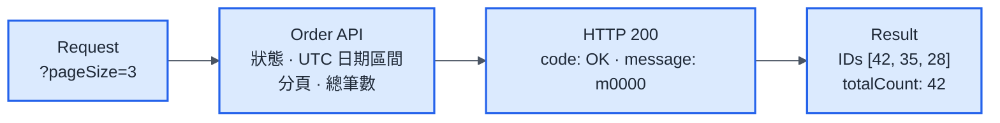

Slide 4 · 第一章 · 01 · B3

# 交辦一支訂單查詢 API，功能確實能跑

  系統／契約路徑
  案例邊界

  
共同結果：AI-direct 與 Project-convention 都回傳這組成功資料。

  
Evidence boundary：Browser MSW · 受限 SQL evaluator · 固定 fixtures

<!--
PRESENTER NOTES:
Key points:
- 交辦支援狀態、UTC 日期區間、分頁與總筆數。
- 這一頁只建立「功能路徑可以成功」的起點。
- 不把結果描述成真實 API Server 或真實資料庫執行證據。
Evidence: PR #13 head e8ae8ad3d419cf51927d69b598ea4e00ad6cf329; application.ts; browser.test.mjs.
Limitation: Chromium Browser MSW、受限 SQL evaluator、固定 fixtures。
Transition: 從正常結果轉向錯誤回應與既有 Consumer 的整合契約。
Timing: variable; main talk excludes Q&A.
-->

<!-- TODO: Visual opportunity - HIGH · implemented in Visuals
Type: Mermaid flow diagram with semantic triad and v-click annotations.
Suggestion: The diagram replaces the repeated data rows; reveal the shared result before the evidence boundary.
Element count: 4 system nodes + 2 narrative annotations = 6.
-->
