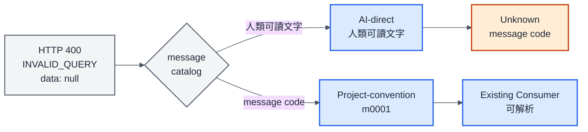

Slide 5 · 第一章 · 02 · B2 → B3

# message 不是自由文字，而是既有 UI 契約

  系統／契約路徑
  契約落差
  案例邊界

  
先看落差：人類可讀文字在既有 Consumer 前形成 Unknown message code。

  
再看相容：m0001 沿著既有 message catalog 被 Consumer 解析。

<!--
PRESENTER NOTES:
Opening: fromDate without toDate creates the invalid-query case.
Key points:
- message 不是自由文字，而是既有 Consumer 可識別的訊息代碼。
- AI-direct 的人類可讀文字無法被既有 Consumer 解析。
- Project-convention 的 m0001 可以被既有 Consumer 解析。
Evidence: application.ts; domain.ts; existing-consumer.ts; message-catalog.ts; browser.test.mjs, all from PR #13 revision e8ae8ad3.
Limitation: Browser MSW 的 Chromium 合成案例；不是外部 API Server 或真實資料庫執行證據。
Transition: 從對外 Response 的契約，擴展到內部架構與命名的責任分層。
Timing: variable; main talk excludes Q&A.
-->

<!-- TODO: Visual opportunity - HIGH · implemented in Visuals
Type: Mermaid branching contract diagram with semantic triad and v-click annotations.
Suggestion: The diagram replaces the repeated response/path text; reveal the incompatibility before the compatible message-code path.
Element count: 6 diagram nodes + 2 narrative annotations = 8.
-->
