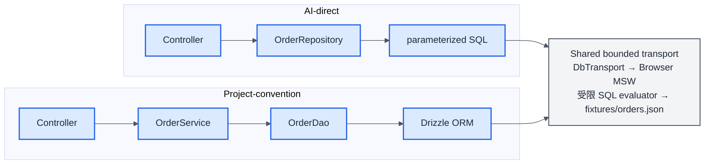

Slide 6 · 第一章 · 02 · B2 → B3

# 既有契約也藏在命名與責任分層

  系統／責任路徑
  共同案例邊界

  
命名與責任：兩條實作路徑不同，但都沿著可辨識的模組責任合作。

  
共同邊界：兩條路徑最後都進入同一個 bounded transport；這不是 production database 證據。

<!--
PRESENTER NOTES:
Key points:
- 交付相容性也包含既有命名、責任與依賴分層。
- 兩條路徑不是獨立的技術優劣比較，而是既有專案慣例如何影響交付。
- 共同案例路徑使用 Browser MSW 與受限 SQL evaluator。
Evidence: application.ts; worker.ts; README.md from PR #13 revision e8ae8ad3.
Limitation: 這是案例中的合理分層，不表示層數越多越好；不是真實資料庫執行證據。
Transition: 當我們用這些既有約定驗收，才看見交辦與規格之間的落差。
Timing: variable; main talk excludes Q&A.
-->

<!-- TODO: Visual opportunity - HIGH · implemented in Visuals
Type: Mermaid responsibility architecture with semantic triad and v-click annotations.
Suggestion: The diagram replaces the repeated path text; reveal responsibility naming before the shared bounded transport boundary.
Element count: 2 paths + 1 shared boundary + 2 narrative annotations = 5.
-->
