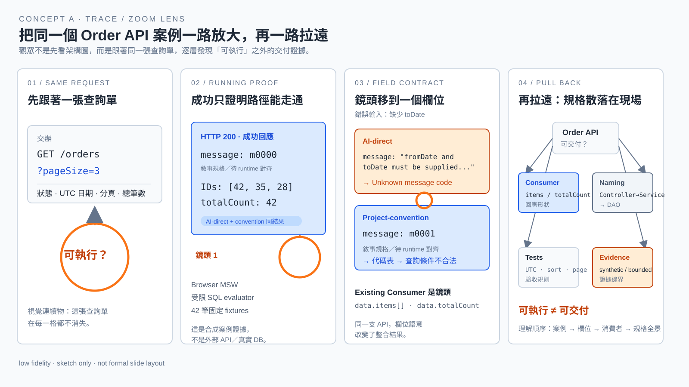
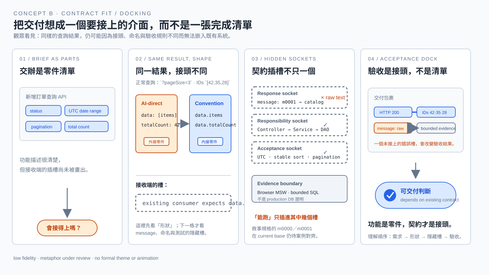
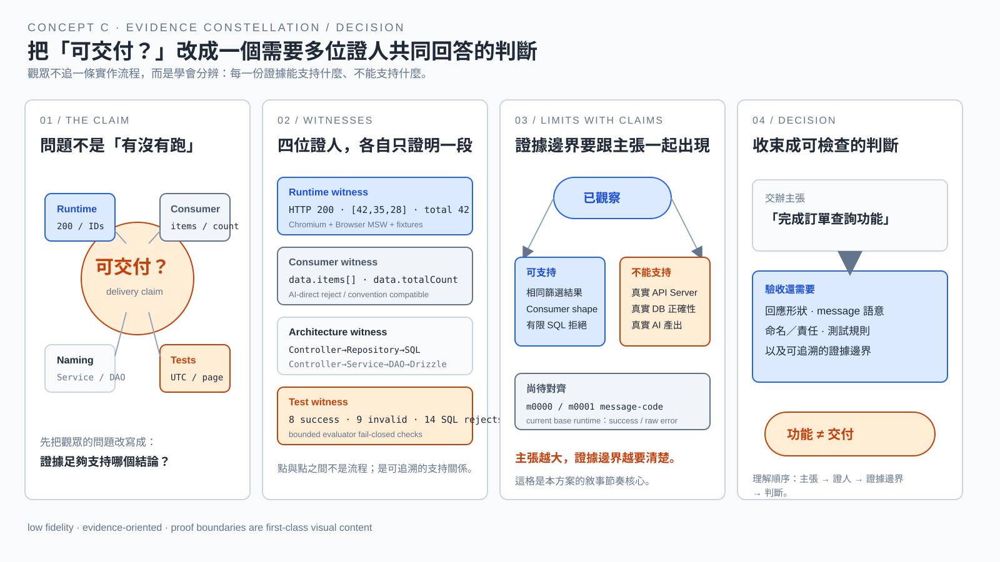

# Visual Design Explore｜Concept Board

> 狀態：Explore only。這份 Concept Board 是視覺敘事實驗，不是正式 Storyboard、Slidev 實作或 Theme 定稿。
>
> 範圍：正式 Slide 3–7 的整段敘事；三組草圖各自是「理解過程」的低精度序列，不對應固定頁數或 Click 數。

## 1. 設計問題

### 觀眾起點

觀眾大致知道「新增一支訂單查詢 API」會包含狀態、UTC 日期區間、分頁與總筆數，也容易把 `HTTP 200`、訂單 ID 和 `totalCount` 看成「已完成」。他們未必先想到：既有 Consumer、回應欄位語意、命名／責任分層、測試規則與證據來源，也可能是交付條件。

### 希望觀眾離開時理解

> 功能可以執行，是交付的必要起點，不是充分條件。

同一個 Order API 案例要帶觀眾完成四次理解變化：

1. 從可見的成功結果開始：`?pageSize=3` → `HTTP 200` → `[42, 35, 28]`、`totalCount: 42`。
2. 把注意力移到欄位語意：既有 Consumer 讀取 `data.items[]`／`data.totalCount`，不是只看 HTTP 狀態。
3. 從對外 Response 擴展到內部合作：`Controller → Repository → parameterized SQL` 與 `Controller → Service → DAO → Drizzle (sqlite-proxy)` 是不同的責任／命名路徑。
4. 回到驗收判斷：既有規格和測試決定「可交付」能被支持到什麼程度；Browser MSW／受限 SQL evaluator 的證據邊界也要一起說清楚。

### 必須正確保留的事實與限制

- 案例是單一、原創、合成的 TypeScript Order API；固定 fixtures 有 42 筆訂單。
- `?pageSize=3` 的成功案例可觀察到 `IDs [42, 35, 28]`、`totalCount: 42`；兩條路徑產生相同篩選資料。
- AI-direct：`Controller → OrderRepository → parameterized SQL`。
- Project-convention：`Controller → OrderService → OrderDao → Drizzle (sqlite-proxy)`。
- Existing Consumer 要求 `data.items[]` 和 `data.totalCount`；這個回應形狀差異是目前可執行案例已明確驗證的相容性重點。
- 案例在 Chromium 內由 Browser MSW 攔截 API／DB，底層是受限 SQL evaluator 與固定 fixtures；不是外部 API Server，也不是真實資料庫執行證據。
- Browser test 目前支持 8 組成功查詢、9 組 invalid input、14 組 unsupported SQL rejection；它們支持的是合成案例的行為與 fail-closed 邊界。
- `m0000`／`m0001` 是現行內容規劃與分鏡使用的訊息代碼敘事；`feat/presentation-step5` 的現行 runtime source 仍輸出 `success`／原始錯誤文字，尚未完成對齊。草圖把這組內容標成「敘事規格／待 runtime 對齊」，不把它當成已驗證的執行證據。

來源：[`docs/presentation-plan.md`](../../docs/presentation-plan.md)、[`docs/slide-copy.md`](../../docs/slide-copy.md)、[`docs/ch01-ch02-ssot-alignment.md`](../../docs/ch01-ch02-ssot-alignment.md)、[`docs/storyboards/ch01.md`](../../docs/storyboards/ch01.md)、[Order API README](../../examples/order-api/ts-v1/README.md)、[`application.ts`](../../examples/order-api/ts-v1/src/application.ts)、[`existing-consumer.ts`](../../examples/order-api/ts-v1/src/existing-consumer.ts)、[`browser.test.mjs`](../../examples/order-api/ts-v1/test/browser.test.mjs)。

## 2. PR #20 作為比較基準

[PR #20｜cc-slidev Pilot](https://github.com/TsaoHoward/ai-engineering-talk/pull/20) 的基準值得保留：

- 用 Slide 3 的問題句建立「可執行／可交付」張力。
- Slides 4–6 用藍／橘／灰承擔「系統／契約路徑、契約落差、案例邊界」語意，而不是把某條實作路徑畫成技術優勝者。
- Slide 7 回收「交辦 vs 既有規格」，並在揭露後才出現 acceptance 判斷。
- 有意識地標示 Browser MSW、bounded SQL、fixed fixtures 的證據邊界。

本次不延續 PR #20 的核心構圖：它是「每頁選一種表達」的 Slidev pilot——Slide 4–6 以 Mermaid 流程／分支／責任架構為主，Slide 7 以雙欄比較加 acceptance gate 收束，並以 v-click 做頁內揭露。它的整段觀看仍主要是「看見幾張圖」，未決定觀眾到底以什麼心理模型理解這五頁。

PR #20 也留下三個需要在探索階段重新思考的點：

- Slide 5／6 的 Mermaid label 在 16:9 下偏小；Balance report 將 `small-labels` 記為已知限制。
- Slide 5 的 message-catalog 語意與現行程式對齊問題被記錄，但沒有在 Visuals／Balance 階段重新驗證。
- Slides 4–6 的 click 0 先顯示完整圖，再揭露注釋；這適合展示圖形，但不一定最適合建立「從功能到隱含契約」的理解順序。

因此本次候選方案的差異不在配色、版型或圖形樣式，而在觀眾被要求採用的理解方式。

## 3. 候選概念 A｜Trace / Zoom Lens

### 核心表達策略

把「同一張查詢單」作為視覺連續物。觀眾先看到 `GET /orders?pageSize=3`，再看成功回應，再用一個視覺上的鏡頭移到 `message` 欄位，最後拉遠到 Consumer、Naming、Tests、Evidence 四個規格來源。

這不是把 request、response、consumer 畫成 runtime pipeline；它是「同一個案例被逐層檢查」的視覺隱喻。若採用，所有箭頭都應標成檢視／聚焦關係，避免被理解成未經證明的執行順序。

### 草圖序列與預期理解

1. **Same request**：先接受功能交辦，建立案例記憶點。
2. **Running proof**：看到 `HTTP 200`、`[42, 35, 28]`、`totalCount: 42`，但旁邊立即保留 synthetic／bounded evidence boundary。
3. **Field contract**：同一張查詢單不變，鏡頭只改看 `message`；raw text 與 `m0001` 的整合結果不同，並把後者標為敘事規格待對齊。
4. **Pull back**：觀眾把欄位、Consumer shape、命名／責任和測試視為同一個交付判斷的背景。

### 優勢、限制與取捨

- **優勢**：視覺連續性最強；很適合講清楚「正常結果沒有被否定，只是檢查深度增加」；可把 Slide 4 → 5 的成功／錯誤切換做成同一案例的焦距變化。
- **限制**：拉遠後的四個規格來源可能變成資訊牆；架構路徑的責任關係不如 PR #20 的流程圖直接。
- **取捨**：以「深度檢視一個案例」換取「一次看全架構」；需要講者明確說出鏡頭不是 runtime trace。

### 與 PR #20 的實質差異

PR #20 把每頁的核心關係畫成 Mermaid flow／branch／architecture；A 把整段敘事組織成一次持續的 inspection。觀眾記住的是「我一路把同一個交付物放大檢查」，不是「我看過三種圖」。

## 4. 候選概念 B｜Contract Fit / Docking

### 核心表達策略

把 API 交付視為要接入既有系統的「接頭／插槽」問題。交辦先提供功能零件；既有 Consumer、message 語意、責任／命名、UTC／排序／分頁測試則是接收端的隱藏插槽。兩條實作路徑可以產生相同訂單資料，但回應 shape、責任分層與訊息契約是否接得上，會改變驗收結果。

這個方案使用物件接合的比喻，不主張 `Service → DAO` 在所有專案都比 `Repository → SQL` 好；插槽標籤要寫成「project convention／existing contract」，不能寫成普遍架構規則。

### 草圖序列與預期理解

1. **Brief as parts**：觀眾看到交辦裡確實有功能零件，但還沒有接收端。
2. **Same result, shape**：`[42, 35, 28]` 與 `totalCount: 42` 相同，但 AI-direct 的 `data: [items]` 和 convention 的 `data.items`／`data.totalCount` 形狀不同。
3. **Hidden sockets**：補上 message-code、`Controller → Service → DAO`、UTC／stable sort／pagination，以及 Browser MSW／bounded SQL 的 evidence boundary。
4. **Acceptance dock**：驗收被視為接頭；只要有一個必要插槽沒有接上，功能完成不等於可交付。

### 優勢、限制與取捨

- **優勢**：把「隱含契約」具體化，觀眾一眼能看見為什麼功能結果相同仍可能無法整合；容易製造可記憶的 before／fit／reject 轉折。
- **限制**：接合比喻容易把契約誤讀成全有全無，也可能讓人以為所有架構層都必須固定；`message` 的敘事規格／runtime mismatch 會讓插槽看起來比目前證據更確定。
- **取捨**：以直覺與記憶點換取技術細節的精確層次；必須把「已驗證 shape」「敘事規格」「尚未證明的 runtime」分開標記。

### 與 PR #20 的實質差異

PR #20 以路徑與比較欄位呈現差異；B 以「交付物是否能嵌入既有接收端」作為主視角。它不要求觀眾先讀懂 Mermaid 的節點方向，而是先理解 compatibility／fit，再回頭看哪些規格形成接頭。

## 5. 候選概念 C｜Evidence Constellation / Decision

### 核心表達策略

把 `可交付？` 視為一個需要多位「證人」共同支持的判斷。Runtime、Consumer、Architecture、Tests 各自提供一段證據；它們不是一條流程，而是指向同一個 claim 的可追溯支持關係。每個 claim 同時展示「可支持」與「不能支持」的範圍。

這個方案把證據限制提升為第一級視覺內容：`HTTP 200` 可支持合成案例中的成功路徑，但不能支持真實 API Server／真實 DB／真實 AI 產出；`m0000`／`m0001` 則以「尚待對齊」獨立呈現。

### 草圖序列與預期理解

1. **The claim**：先把問題由「有沒有跑」改成「證據足夠支持哪個結論」。
2. **Witnesses**：逐一召集 runtime、consumer、architecture、test 四類證據，保留真實案例欄位與數字。
3. **Limits with claims**：把「可支持／不能支持／尚待對齊」並列，讓證據限制跟主張同步出現。
4. **Decision**：回到交辦的「完成訂單查詢功能」，再補上 response shape、message 語意、命名／責任、測試與可追溯邊界，形成可檢查判斷。

### 優勢、限制與取捨

- **優勢**：最準確地承接 Slide 7 的「驗收依賴既有規格」；能避免把 Browser MSW 成功誤說成 production evidence；也能自然容納目前的 message-code 對齊問題。
- **限制**：對第一次接觸案例的觀眾，四類證人可能比「一條流程」更抽象；若每個證人都塞入細節，會變成審查報告而不是敘事。
- **取捨**：以證據與判斷的清晰度換取立即的戲劇性；需要只挑一個代表性失配（`data.items` 或 `message`）作為情緒焦點，其餘保持為支持線索。

### 與 PR #20 的實質差異

PR #20 以 Mermaid 圖展示系統／契約路徑，再由 Slide 7 加一個 acceptance gate；C 從一開始就以「claim → witnesses → limits → decision」組織整段敘事。Acceptance 不是最後才加上的元件，而是每一份視覺證據都要回答的問題。

## 6. 三案比較

| 方案 | 觀眾採用的理解方式 | 最強的敘事轉折 | 最容易誤讀的地方 | 與 PR #20 的距離 |
| --- | --- | --- | --- | --- |
| A · Trace | 我正在逐層檢查同一個交付物 | 成功結果 → 聚焦欄位 → 拉遠到規格背景 | 把視覺箭頭看成 runtime trace | 中高：保留案例連續性，改變整段觀看視角 |
| B · Fit | 我在把交付物接入既有系統 | 零件清單 → 隱藏插槽 → 接不上／接得上 | 把架構慣例誤認成普遍標準 | 高：從路徑比較改成 compatibility metaphor |
| C · Proof | 我在判斷證據能支持什麼主張 | 可觀察 → 證人 → 證據邊界 → 判斷 | 變成過度報告化、失去案例張力 | 最高：從頁面圖形改成 claim/evidence mental model |

## 7. 自主設計批評與篩選

### Expressiveness

- A 正確保留同一案例、成功結果、Consumer shape、架構路徑與 evidence boundary，但必須用「檢視」線而非「執行」線。
- B 能表達 compatibility，但比喻有把所有契約二元化的風險；已在草圖中把 `m0000`／`m0001` 標成敘事規格，避免把尚未對齊的 runtime 說成事實。
- C 最能同時表達支持關係與證據限制；`current base runtime：success / raw error` 的註記是必要防錯，不是新增敘事內容。

三案沒有重大技術語意錯誤，因此保留供比較；但已淘汰以下不納入候選的方向：

- **純拓撲牆**：只把 PR #20 的三張 Mermaid 圖換成另一種節點樣式，沒有改變觀眾理解方式。
- **AI vs 人類角色插圖**：會暗示這是真實 AI 產出或模型評測，超出案例證據。
- **Before／after 配色版本**：只改版型或顏色，不構成獨立視覺概念。

### Effectiveness / Narrative / Cognitive Load / Continuity

| 檢查 | A · Trace | B · Fit | C · Proof |
| --- | --- | --- | --- |
| Effectiveness | 讓成功與後續檢查保持同一脈絡 | 讓隱含契約變得可見、可記 | 讓「證據不等於主張」可直接判讀 |
| Narrative | 聚焦深度逐步增加 | 從零件到接合，衝突最具體 | 從 claim 到 decision，論證最完整 |
| Cognitive Load | 持續物降低跳轉，但規格全景可能偏滿 | 比喻降低抽象度，但插槽數量要控制 | 證人與邊界較多，必須只保留代表證據 |
| Continuity | 最強：同一張查詢單貫穿 | 中等：交付包裹／接收端貫穿 | 中等：中心 claim 貫穿，證人會替換 |

### 已知設計取捨 vs 尚未確認問題

**明確取捨**

- 不以架構層數或技術名稱的多寡表達優劣。
- 不把 `m0000`／`m0001` 的敘事規格混入已驗證 runtime 證據。
- 不用 Mermaid 作為必要前提；若未來採用 Mermaid，也只能是候選概念落地後的媒介選擇。
- 不把四格草圖當正式頁碼、Click 或動畫規格。

**尚未確認**

- 觀眾是否更容易先理解 `data.items` shape，還是先理解 `message` catalog；這是下一階段可用最小 prototype 驗證的順序問題。
- Slide 3 的問題句是否需要作為三案共同的開場，或讓某個方案直接從 Order API 交辦開始。
- 若保留四類 evidence，正式投影下每一類能展示多少真實 code／test 片段而不超過認知負荷。

## 8. 推薦方向

推薦 **Concept C · Evidence Constellation / Decision** 作為下一步的主敘事方向，理由有三：

1. 它最直接回答這段內容真正要改變的理解：從「功能跑了」轉為「交付判斷需要哪些可追溯規格與證據」。
2. 它能把 Browser MSW、bounded SQL、synthetic fixture 與 message-code 待對齊問題放在同一個證據框架，不需要用小字備註事後補救。
3. 它與 PR #20 的頁面級 Mermaid pilot 有最大實質差異，適合真的比較視覺敘事方向，而不是再次優化既有流程圖。

可選的輔助借用是 A 的「同一張查詢單」作為視覺連續物；這只應作為 C 的入口記憶點，不應把 C 重新變成一條流程圖。B 適合保留為備選，尤其當使用者希望優先強化「整合失配」的記憶點時；但必須接受其比喻的語意風險。

## 9. 需要使用者參與的設計決策

只需要使用者在下一階段選擇以下方向，不需要逐一決定版型：

1. **主理解模型**：選 C 的「證據與判斷」、A 的「逐層檢視」，或 B 的「接合與失配」作為正式視覺敘事的主軸。
2. **衝突焦點**：以 `data.items`／`data.totalCount` 的 Consumer shape 作為已驗證的主要失配，或等 message-code runtime 對齊後再把 `m0001` 作為主要失配。
3. **證據揭露深度**：主畫面只顯示證據摘要與限制，還是要展示少量 `application.ts`／Consumer／browser test 原始片段。

在這三項決策前，本實驗停止於 Explore；不修改正式簡報、敘事文案、案例 SSOT、Theme、CI/CD 或共用元件。
