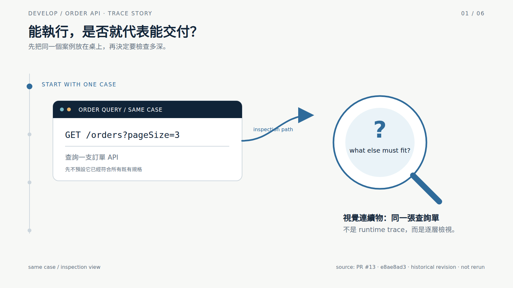
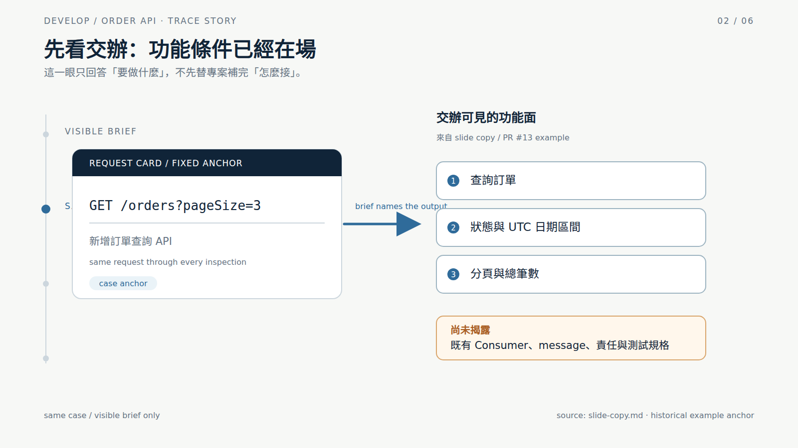
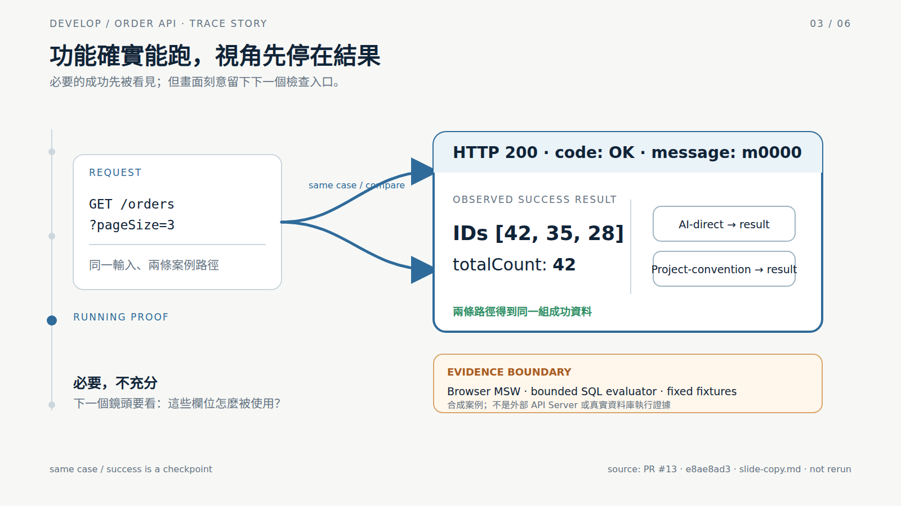
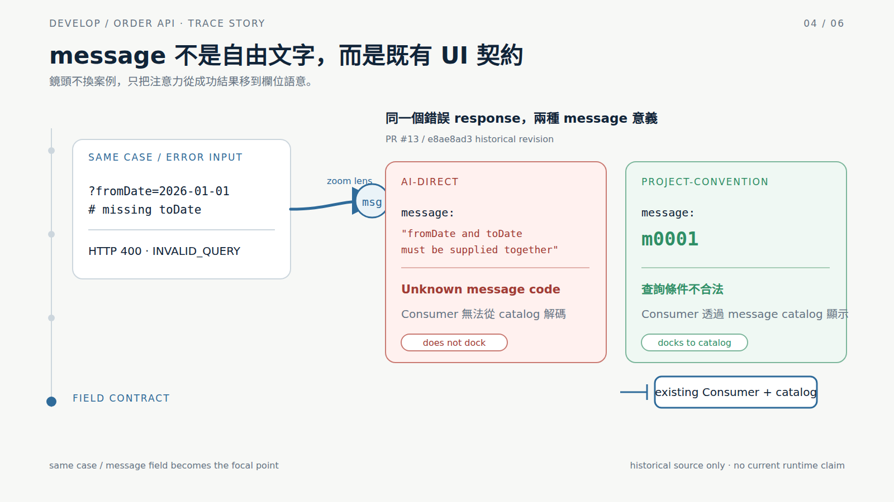
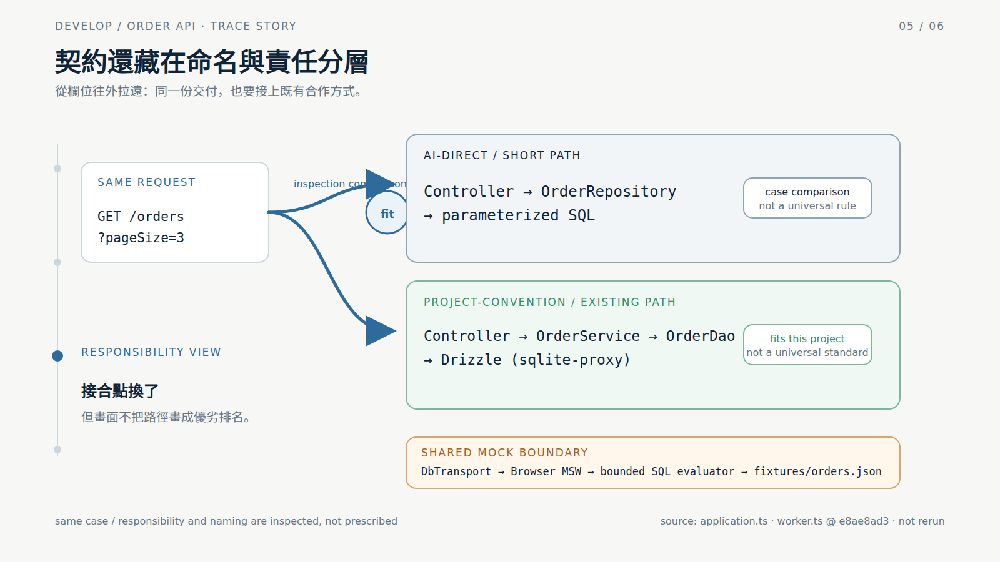
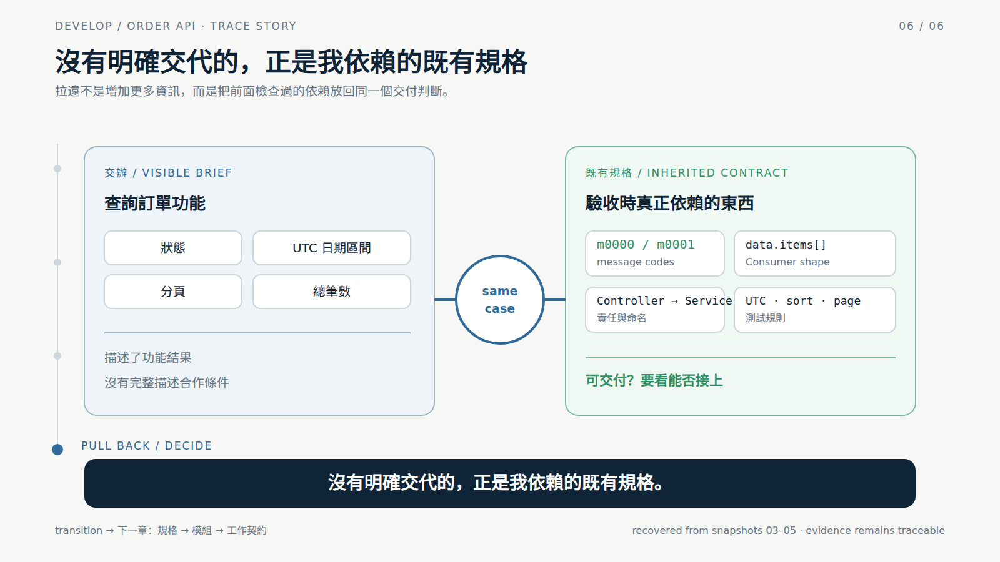

# Visual Design Develop｜Design Storyboard

> 狀態：Develop only。這是一組可觀看的視覺分鏡原型，不是正式投影片、Slidev 實作或 Validate 結果。
>
> 範圍：正式 Slide 3–7 的 Order API 敘事；本輪以 `docs/slide-copy.md` 指定的 PR #13 revision `e8ae8ad3d419cf51927d69b598ea4e00ad6cf329` 作為主要案例設計依據。

## 1. 核准方向如何整合

本輪採用 **Concept A — Trace / Zoom Lens** 作為唯一主敘事：同一張 `GET /orders?pageSize=3` 查詢卡片從「交辦」開始，依序被檢視為成功結果、`message` 欄位、Consumer 接合點、責任／命名路徑，最後拉遠回到既有規格。

**Concept B — Contract Fit / Docking** 只在兩個必要節點出現：

- Snapshot 04 以 `message` 與 `existing Consumer + catalog` 的接合／失配具體化已核准的 message-code 案例。
- Snapshot 05 以「接上這個 project convention」說明責任與命名；不把 `Controller → Service → DAO` 宣稱成所有專案的標準，也不把兩條案例路徑畫成優劣排名。

**Concept C — Evidence and Semantic Constraints** 不作主視覺。`Browser MSW`、bounded SQL、fixed fixtures、historical revision 與 `not rerun` 只保留為畫面底部的證據標籤或文件來源 guard，避免證據邊界取代本章的核心教學。

整段最後收束為：

> **沒有明確交代的，正是我依賴的既有規格。**

這個收束同時銜接下一章的「規格 → 模組 → 工作契約」。

## 2. 暫定視覺語言

這不是完整 Design System；只定義足以承載本段內容的少量規則。

| 面向 | 暫定規則 |
| --- | --- |
| 畫布 | 1600×900、暖白背景、約 9% 外框留白；適合明亮會議室投影 |
| 字體 | `Noto Sans TC / Inter` 作標題與說明；`JetBrains Mono / Consolas` 作 request、message、path |
| 基準色 | Ink `#102438`、Trace blue `#2F6B9A`、muted `#667483` |
| 語意色 | Amber `#A95D22` 表示限制／未接合；green `#2F8F66` 表示此案例中的接合；不以顏色單獨承載意義 |
| 核心物件 | `ORDER QUERY / SAME CASE` 卡片、藍色 inspection path、圓形 zoom lens；每張都保留最小版查詢識別 |
| Docking 形狀 | 簡單 socket、pill 與邊框，只說明「此案例接得上／接不上」；不使用通用架構圖例 |
| 證據位置 | 底部或次要卡片；字面標註 `historical revision`、`not rerun`、`mock boundary` |
| 觀看節奏 | 問題 → 可見交辦 → 成功 checkpoint → message 衝突 → 責任分層 → 拉遠收束 |

Snapshot 02 與 Snapshot 04 是暫定 Style Tile 的代表構圖：前者確認「卡片 + 條件標籤 + lens」能承載可見需求，後者確認同一語言能承載錯誤 response、Consumer 與 docking 失配。其餘畫面只改變視覺焦點與資訊密度，不建立另一套系統。

## 3. Snapshot sequence

本輪交付 **6 個 Snapshot**。它們不等同於 5 張正式 Slide 或固定 click 數；Snapshot 02 是必要的交辦 staging，可以在正式實作時作為 Slide 4 的前段揭露或與 Snapshot 03 合併。

### Snapshot 01｜問題先於答案

[SVG 原始產物](svg/01-question.svg)

- **觀眾此時已知**：上一頁剛說明要用同一個 Order API 放大視角；尚未看到案例細節。
- **需要形成的新理解**：`可執行` 與 `可交付` 是待檢查的兩個判準，不先假設它們相等。
- **講者負責**：提出問題，說明接下來會逐層檢視同一個案例；明確說明藍線是 inspection path，不是已證明的 runtime trace。
- **畫面負責**：用中央的查詢卡片和放大鏡建立記憶點；不提前展示 Consumer、message 或架構答案。
- **當前視覺焦點**：`GET /orders?pageSize=3` 與問號 lens。
- **相較前一畫面**：新增案例錨點；移除所有解答性細節；保留問題的空間。

### Snapshot 02｜只先看交辦

[SVG 原始產物](svg/02-brief.svg)

- **觀眾此時已知**：問題已落到一個訂單查詢 API；查詢卡片是全段的同一個案例。
- **需要形成的新理解**：交辦已清楚描述查詢功能、狀態、UTC 日期區間、分頁與總筆數，但尚未交代合作條件。
- **講者負責**：念出／概括功能要求，提醒「這些是可見 brief，不是完整 acceptance contract」。
- **畫面負責**：把可見需求放在右側標籤，把 `Consumer / message / 責任 / 測試` 放進「尚未揭露」區，不讓它們變成已知答案。
- **當前視覺焦點**：左側同一張 request card，接著移到右側四個功能標籤。
- **相較前一畫面**：保留查詢卡片與 trace rail；加入功能條件；暫不加入任何結果或失配。

### Snapshot 03｜成功是 checkpoint，不是結論

[SVG 原始產物](svg/03-success.svg)

- **觀眾此時已知**：交辦要求查詢訂單，且請求是 `?pageSize=3`。
- **需要形成的新理解**：在 PR #13 revision 的案例中，兩條實作路徑都能得到 `HTTP 200`、`message: m0000`、`[42, 35, 28]` 與 `totalCount: 42`；這是必要成功，但還不是完整交付判斷。
- **講者負責**：說明這個成功結果只支持合成案例中的執行路徑；不把它說成外部 API Server、真實 DB 或真實 AI 產出。
- **畫面負責**：讓兩條路徑匯聚到同一個結果面板，並在結果下方保留一個小而可讀的 evidence boundary，而不是讓限制搶走主焦點。
- **當前視覺焦點**：`HTTP 200` 與 `[42, 35, 28] / totalCount: 42`。
- **相較前一畫面**：保留 request card；加入成功結果與兩條路徑的共同結果；移除「尚未揭露」大框，改成「下一個鏡頭看欄位如何被使用」。

### Snapshot 04｜把鏡頭停在 message

[SVG 原始產物](svg/04-message.svg)

- **觀眾此時已知**：成功結果成立，且相同輸入可以沿兩條案例路徑得到資料。
- **需要形成的新理解**：錯誤輸入 `?fromDate=2026-01-01` 缺少 `toDate` 時，歷史 revision 的兩條路徑都回 `HTTP 400 / INVALID_QUERY`，但 `message` 語意不同：raw text 無法被既有 Consumer 解碼，`m0001` 可由 catalog 顯示「查詢條件不合法」。
- **講者負責**：先說「欄位被誰消費」再解釋 docking；明確指出這是 message-code 的主要失配，不把本輪核心案例換成 response shape。
- **畫面負責**：用同一張 error request card 把 lens 引向 `msg`，再讓兩個 response card 分別接到 `does not dock`／`docks to catalog`；`m0001` 與 raw text 的差異成為唯一主衝突。
- **當前視覺焦點**：`message` 值、Consumer 解碼結果與 catalog socket。
- **相較前一畫面**：保留 same-case 識別；將成功面板取代為錯誤 response；把 B 的 docking 隱喻加入，但不延伸為所有 API 都必須使用 message code。

### Snapshot 05｜從欄位拉到責任

[SVG 原始產物](svg/05-layers.svg)

- **觀眾此時已知**：對外欄位的語意會影響既有 Consumer；接著要看內部合作方式。
- **需要形成的新理解**：同一個案例還依賴 project-specific 的命名與責任分層：`Controller → OrderRepository → parameterized SQL` 與 `Controller → OrderService → OrderDao → Drizzle (sqlite-proxy)` 是兩種被比較的路徑；案例採用的 shared mock boundary 另行標示。
- **講者負責**：說明這是案例中的合理分層與相容性檢查，不宣稱「層越多越好」或某一架構是通用標準。
- **畫面負責**：用同一個 request card 分出兩條比較 lane；用 `case comparison / not a universal rule` 和 `fits this project / not a universal standard` 抑制誤讀；把 `DbTransport → Browser MSW → bounded SQL evaluator → fixtures/orders.json` 壓到次要 mock boundary。
- **當前視覺焦點**：兩條責任／命名路徑的接合點。
- **相較前一畫面**：保留 lens／trace 語言但拉遠焦距；移除 message 的左右比較；加入責任路徑與 mock boundary；把 docking 從欄位接合轉為專案合作接合。

### Snapshot 06｜拉遠並收束

[SVG 原始產物](svg/06-close.svg)

- **觀眾此時已知**：功能結果、message Consumer、命名／責任分層與案例證據邊界都已被檢視。
- **需要形成的新理解**：交辦只描述功能；可交付判斷依賴既有 message code、Consumer shape、責任／命名與 UTC／排序／分頁測試規則。
- **講者負責**：逐項回收前面已出現的內容，說出本段核心收束，並把視線導向下一章的規格、模組合作及工作契約。
- **畫面負責**：把「交辦」與「既有規格」放在同一視野，中間保留 same-case lens；底部用單一深色收束帶承載完整句子，避免再增加新證據。
- **當前視覺焦點**：`沒有明確交代的，正是我依賴的既有規格。`
- **相較前一畫面**：移除兩條具體實作路徑與細節；保留並重新聚焦四類已揭露規格；新增下一章 transition。

## 4. Source guard 與案例邊界

### 本輪設計採用的歷史 revision

以下內容取自 `e8ae8ad3d419cf51927d69b598ea4e00ad6cf329` 的 source inspection，作為設計依據：

- `src/application.ts`：`m0000/m0001` response message、AI-direct 與 project-convention 路徑。
- `src/domain.ts`：`MESSAGE_CODES`、UTC/date/pagination input rules。
- `src/existing-consumer.ts`：success envelope 與 error message-code 解碼契約。
- `src/message-catalog.ts`：`m0001 → 查詢條件不合法` 的前端對照表。
- `test/browser.test.mjs`：歷史 revision 中的成功查詢、invalid input、Consumer 相容性與 bounded SQL rejection 規格。
- `src/worker.ts`、`docs/browser-msw-architecture.md`：Browser MSW、bounded SQL evaluator、fixed fixtures 的 mock 邊界。

本輪未執行 `npm run verify`、Chromium、Vite preview 或任何 runtime test；因此 storyboard 只聲稱「依 revision 讀取與比對」，不聲稱本輪重新驗證 runtime 行為。

### 目前分支的狀態差異

目前 branch HEAD `b61f7be` 的 runtime source 與上述 revision 有已知落差：`message` 改為 `success`／raw error text、AI-direct response shape 改寫、message catalog 移除，且 browser test 對應修改。這些差異只是本輪的 source guard，不在 Develop 階段修正，也不將目前 branch 的 runtime 當成核准文案案例。

因此畫面中的 `m0000`、`m0001`、Consumer 解碼與 message mismatch 均標記為 **PR #13 historical revision / not rerun**；沒有把既有 Explore 的 response-shape 案例取回作為主要失配。

## 5. 重要設計決策與取捨

- **以 A 取代 Explore board 的推薦 C 作為主軸**：使用者本輪已核准 A 為 primary；C 保留為證據位置與語意限制，不再以 constellation 作為主構圖。
- **同一查詢卡片持續存在，但不固定版型**：它在 S01–S05 是清楚的 card，在 S06 只剩 lens／same-case 連結，避免 continuity 變成每頁重複貼圖。
- **先 success，再 message mismatch**：先讓觀眾承認功能確實能跑，再把檢查深度推進到既有 Consumer；避免一開始就把「不相容」誤讀成「功能失敗」。
- **message 而非 response shape 作為主要衝突**：遵守 `docs/slide-copy.md` 與使用者的 source guard；`data.items[]` 只在收束頁作為已揭露規格之一，不單獨發展成另一個故事。
- **Docking 只在失配處出現**：它提供記憶點但不支配整段視覺；並以 case-specific、not universal 的字樣保護技術語意。
- **證據限制保持可見但不搶戲**：限制只用一個底部卡片或 footer，不把 `Browser MSW`、bounded SQL 或 fixture 數量變成新的主線。
- **6 個 Snapshot 而非 5 張正式 Slide**：Snapshot 02 提供必要的理解停頓；正式實作可合併，不強迫每個 staging 都變成獨立投影片。

## 6. 形成性設計批評

本輪已對 6 張 SVG 產出 1600×900 PNG，並按 01 → 06 的觀看順序檢查實際畫面。這是 Develop 內部 critique，不代表 Validate 已完成。

### 明確缺陷與已修正

- 初稿若把成功結果與 evidence boundary 放在同一視覺重量，會讓「限制」搶過「必要成功」；目前 S03 將 boundary 壓成次要 amber 卡片。
- 若把兩條實作路徑畫成同一條有向 runtime pipeline，會製造未經證明的執行順序；目前 S05 使用 `inspection comparison`、平行 lane 與 case-specific labels。
- 若在 S04 同時放入 response shape、message code、架構與測試，會削弱欄位焦點；目前 S04 只保留 `message` mismatch，其他規格延後至 S05/S06。
- 若 S06 再新增新的證據，收束會變成報告頁；目前只回收已出現的四類規格，並將下一章 transition 放在單一 footer。

### 設計取捨（不是缺陷）

- S04 的左右對比比真實 code 更抽象，但在投影條件下能讓 `raw text → unknown code` 與 `m0001 → catalog` 一眼形成對應；真實 source link 保留在 storyboard 與 evidence note。
- S05 的兩條 path 使用相同 card weight，避免暗示 project-convention 是普遍優勝者；代價是講者必須口頭補充「這是此案例的既有 convention」。
- S06 的交辦／既有規格雙欄比 C 的證據 constellation 更少報告感，也較能服務本章收束；代價是「每個證據能支持什麼」不在主畫面詳列，留給 source guard／speaker notes。

### 尚未確認的問題

- Snapshot 02 應在正式 Slide 4 作為 pre-click，還是與 Snapshot 03 合併為同一個揭露序列？目前建議先合併，保留 staging 的設計理由。
- S04 的 `message` raw text 在正式投影上是否需要再縮短一行？目前文字可讀，但人工審查時應確認投影距離下仍能先讀到「Unknown message code」。
- S05 是否需要顯示完整 `DbTransport → ...` mock boundary？目前保留作次要證據標籤；若講述時間不足，可移到 speaker notes，不應刪掉 source guard。
- 連續物在 S06 是否只保留 `same case` lens，或再保留完整 request card？目前採較低密度的 lens 版本，等待人工設計審查。

## 7. 交付範圍

本目錄保留：

- `svg/01-question.svg` 至 `svg/06-close.svg`：可修改的原始構圖。
- `png/01-question.png` 至 `png/06-close.png`：1600×900 直接預覽，供 PR 逐張檢視。
- 本文件：設計方向、理解順序、source guard、取捨與形成性批評。

Explore 原始產物仍保留於上一層的 `concept-board.md` 與 `sketches/`；本輪沒有修改正式簡報、敘事／案例 SSOT、Theme、共用元件或 CI/CD，也沒有開始 Validate 或正式 Implementation。
